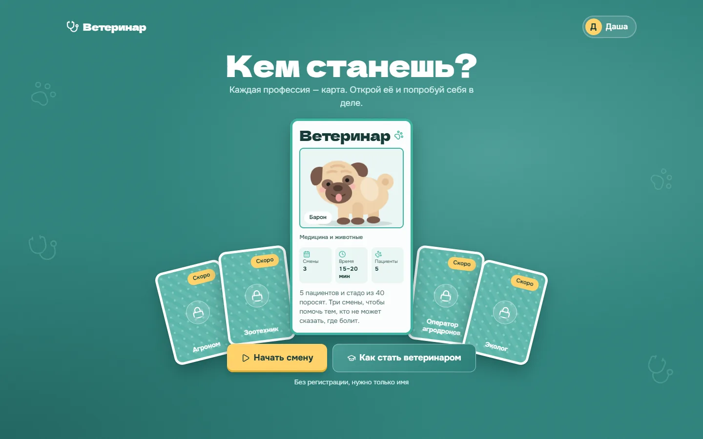
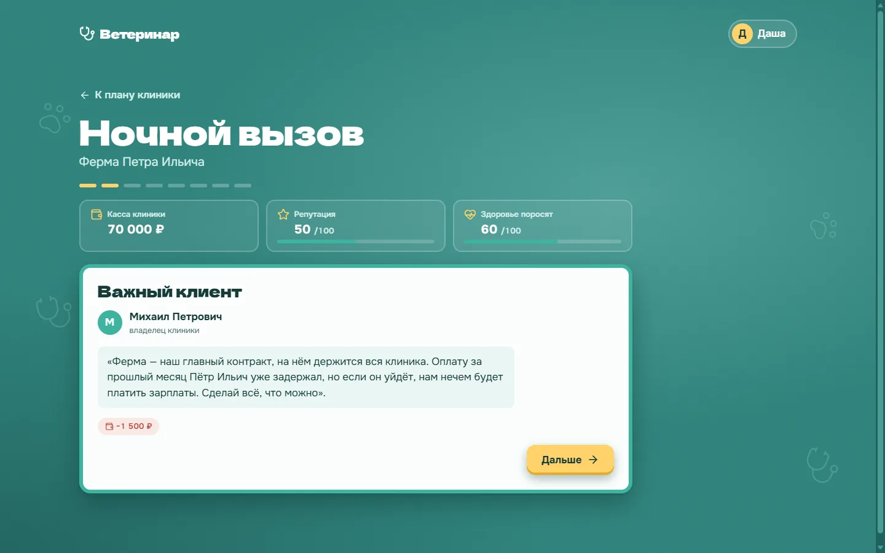
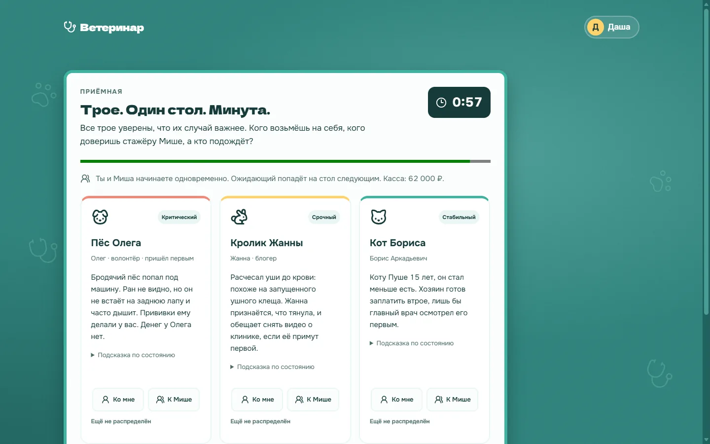
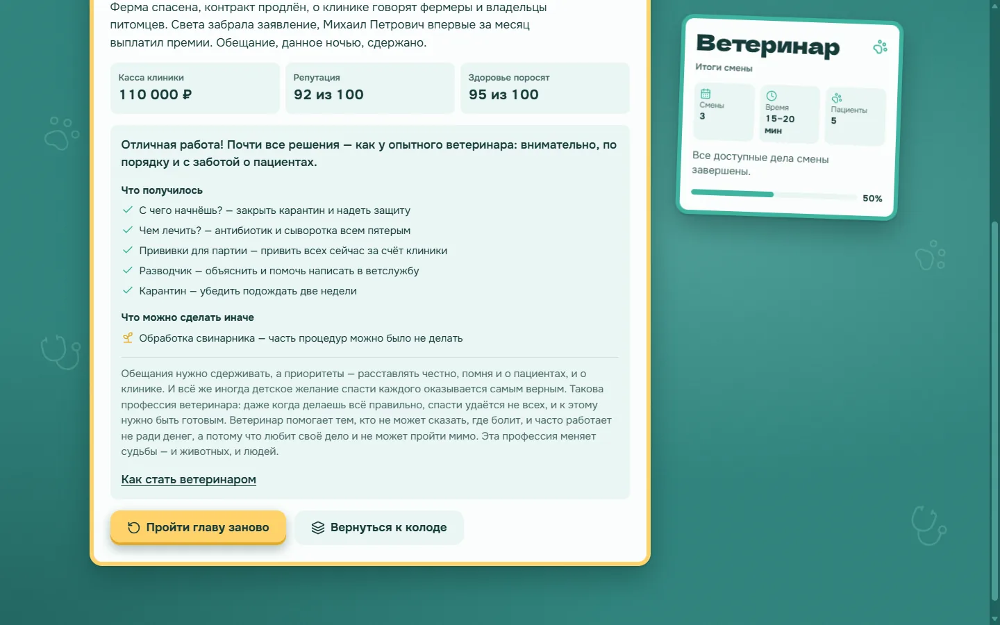
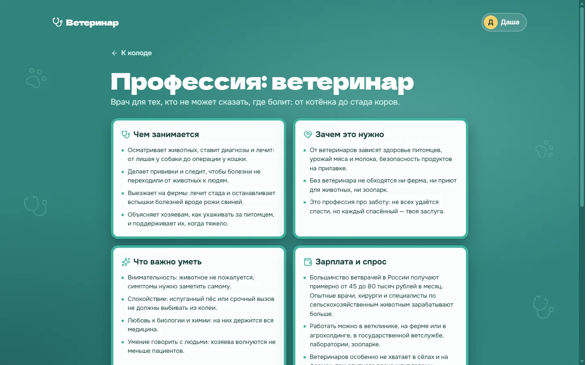

  

# Кем станешь? — профессия «Ветеринар»

Браузерная игра для подростков 14–16 лет: за 15–20 минут игрок проживает три смены главного врача ветклиники и сам решает, кому помочь первым, на что потратить деньги и как сказать владельцу правду.

**Играть:** [http://217.144.184.154:5173](http://217.144.184.154:5173)

> Готовы ли вы каждую секунду брать ответственность за чужую жизнь?

  

## Зачем это нужно

Подростки не знают, кем стать: о профессиях они судят по картинке, а не по тому, как выглядит обычный рабочий день. В это же время рынку не хватает узких специалистов. Ветеринаров особенно ждут в сёлах и на фермах: там опытного врача ищут годами.

«Кем станешь?» — платформа, где профессию не описывают, а дают попробовать. Игрок не читает статью про ветеринара, а работает им: осматривает, ошибается, видит последствия и задумывается, его ли это дело.

## О чём игра

Пятнадцать лет назад у героя заболел пёс Тоша. Ближайший ветеринар был в двух часах езды, и Тоша выжил чудом. Теперь герой сам главный врач ветклиники, но у клиники трудные времена: денег не хватает на зарплаты, часть сотрудников ушла. На главном контракте — ферме Петра Ильича — держится вся клиника, а фермер задерживает оплату.

В 23:10 звонит Пётр Ильич: датчики в новом свинарнике показывают жар у поросят из вчерашней партии. Разводчик клялся, что всех привил. Впереди три смены, чтобы остановить болезнь, сохранить клинику и не потерять себя.

| Смена               | Что происходит                                                                                                                                                                                                                            |
| ------------------- | ----------------------------------------------------------------------------------------------------------------------------------------------------------------------------------------------------------------------------------------- |
| **1. Ночной вызов** | Ночной выезд на ферму: карантин, осмотр поросят, диагноз — рожа свиней, первая помощь заболевшим.                                                                                                                                         |
| **2. Утро без сна** | Обычный приём: пёс Барон с лишаём. Потом очередь из трёх пациентов сразу. Вечером — повторный выезд и главное решение: прививать всё стадо за счёт клиники, которой нечем платить зарплаты, или честно передать ферму тем, кто справится. |
| **3. Развязка**     | Кот Маркиз с занозой, которая загноилась, и операция. Контрольный выезд на ферму: снимать ли карантин и чем всё закончится для стада и клиники.                                                                                           |

## Как это выглядит

<table>
  <tr>
    <td width="50%"> <b>Ночной вызов.</b> Персонажи говорят с тобой, а в карточке можно листать пятерых поросят с разными стадиями рожи.</td>
    <td width="50%"> <b>Очередь.</b> Трое пациентов, один стол и минута на решение.</td>
  </tr>
  <tr>
    <td width="50%"> <b>Итог главы.</b> Разбор решений, похвала и несколько честных слов о профессии.</td>
    <td width="50%"> <b>О профессии.</b> Чем занимается ветеринар, сколько зарабатывает и как им стать.</td>
  </tr>
</table>

## Что делает игрок

**Осматривает, а не угадывает.** Перед любым назначением нужен осмотр. Каждое действие сразу показывает находку, и одна находка ведёт к другой. Хозяин говорит, что кот хромает. При осмотре находишь занозу между пальцами, а горячие уши подсказывают измерить температуру. Жар, которого хозяин не заметил, меняет диагноз.

**Работает с паспортом пациента.** У каждого животного есть паспорт, который можно открыть в любой момент: кличка, возраст, владелец, прививки, чем болел раньше. Там же показатели — температура, пульс, вес — с нормой. Всё, что найдено на осмотре и в анализах, сразу попадает в карту.

**Назначает анализы с оглядкой на чужой кошелёк.** За анализы платит хозяин, и его бюджет ограничен. Нужные анализы дают ответ, лишние стоят денег и доверия.

**Разводит очередь за одну минуту.** В приёмную приходят трое сразу:

- волонтёр с бродячим псом после ДТП: денег нет, но жизнь под угрозой;
- блогер с кроликом обещает видео о клинике, если её примут первой;
- состоятельный владелец пожилого кота готов заплатить втрое.

Стол один, стажёр Миша может взять одного пациента. Кого принять самому, кого отдать Мише, кто подождёт? Таймер — одна минута. Восемь разных исходов.

**Принимает решения главврача.** Колоть ли всем лекарство без осмотра. Брать ли дешёвый препарат. Сообщать ли в ветслужбу о разводчике, который продаёт непривитых поросят. Уговаривать фермера на карантин или пугать штрафом. Правильного ответа «из учебника» часто нет — есть цена каждого варианта.

## Решения меняют показатели

Каждый шаг двигает три счётчика, и они видны всю игру:

- **Касса клиники** — деньги на лекарства, прививки и выезды. Их приносят пациенты, а тратит ферма.
- **Репутация** — доверие хозяев и фермера. От неё зависит, придут ли новые клиенты и согласится ли Пётр Ильич на карантин по-хорошему.
- **Здоровье поросят** — как идёт лечение стада. Оно падает от промедления, экономии и неудачных решений.

После каждого выбора игра объясняет, что из него вышло. Она не говорит «верно» или «ошибка», а показывает последствия: «Марина заплатила, но спрашивает, зачем столько анализов». Ночью случается то, к чему привели вчерашние решения: карантин закрыли поздно — жар появился в дальнем конце свинарника.

## Несколько финалов, а не «гейм овер»

Чем закончится глава, зависит от всего пройденного: кого спас, на чём сэкономил, кому доверился.

- **Клиника снова на ногах** — ферма спасена, контракт продлён, сотрудники возвращаются.
- **Честная передача** — клиника не потянула прививки и сказала об этом прямо: контракт ушёл, но фермер вернул долг и рассказывает о честной клинике всему району.
- **Пустые свинарники** — стадо не спасли, контракт расторгнут.

Потеря — это тоже финал истории, а не проигрыш. После главы игрок получает разбор: что получилось, что стоит сделать иначе, и несколько слов о том, какая это профессия на самом деле. Поэтому главу хочется пройти ещё раз.

## Сложность и подсказки

Перед главой игрок выбирает уровень:

- **Лёгкий** — подробные подсказки на каждом шаге: что проверить и почему;
- **Обычный** — намёки: куда смотреть, без готового ответа;
- **Сложный** — подсказок нет, только осмотр, паспорт пациента и интуиция.

Для первого раза лучше выбрать лёгкий уровень и читать внимательно. Пройти заново, на другом уровне, можно в любой момент.

## Узнать профессию по-настоящему

У каждой профессии есть страница с коротким и честным описанием:

- чем занимается ветеринар и зачем он нужен;
- что важно уметь;
- сколько зарабатывает и где может работать;
- как им стать: колледж после 9 класса или вуз после 11, какие ЕГЭ сдавать. Например, в Ростовской области ветеринаров готовит Донской государственный аграрный университет.

## Играть можно сразу

- **Без регистрации.** Достаточно ввести имя: так к игроку будут обращаться персонажи. Прогресс сохраняется в браузере и не пропадает при перезагрузке.
- **С аккаунтом.** Регистрация по почте и паролю, без подтверждения почты. Если начать как гость, а потом нажать «Сохранить прогресс», аккаунт создаётся сразу с текущим прогрессом — ничего не начинается заново. Дальше играть можно с любого устройства.
- **Профиль.** Показывает уровень и процент прохождения. Там же можно начать профессию заново или удалить аккаунт. Почта нужна только для входа, других личных данных игра не спрашивает.

## Персонажи

  
  &nbsp;&nbsp;&nbsp;
  

- **Ты** — главный врач ветклиники. Имя выбираешь сам.
- **Миша** — стажёр, первая неделя на работе. Может взять пациента из очереди, подготовить операционную, подержать животное.
- **Пётр Ильич** — фермер, самый важный клиент клиники. Переживает за поросят и за деньги, вложенные в новый свинарник.
- **Михаил Петрович** — владелец клиники. Считает каждый рубль, потому что платить зарплаты нечем.
- **Хозяева питомцев** — Марина с Бароном, Егор с Маркизом, волонтёр Олег, блогер Жанна, Борис Аркадьевич с пожилым котом Пушей.

## Колода профессий

Профессии в игре — коллекционные карты. Сейчас открыта карта «Ветеринар». Агроном, зоотехник, оператор агродронов и эколог лежат рубашкой вверх и ждут своих глав: новая профессия — это новая колода сцен, без переделки самой игры.

Мы вдохновлялись игрой про SEO, где каждое решение напрямую меняло показатели. Здесь так же: каждое решение двигает кассу клиники, репутацию и судьбу стада.

## Для разработчиков

Запуск, команды, архитектура и API — в [docs/development.md](docs/development.md). Стандарты фронтенда — в [docs/frontend/](docs/frontend/README.md), путь игрока по экранам — в [docs/app-flow.md](docs/app-flow.md).
