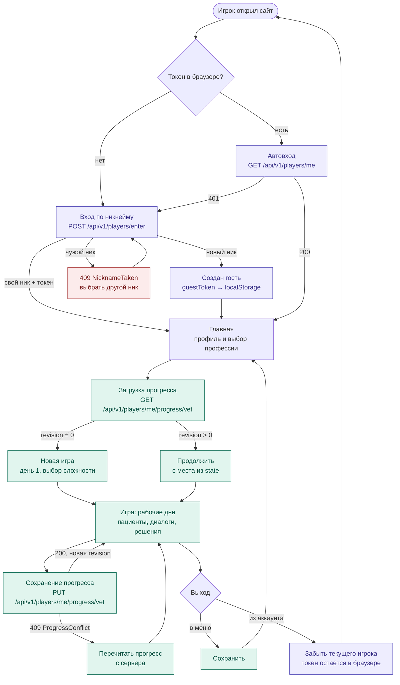

# Схема приложения: от входа до выхода

Путь игрока в общих чертах. Вход и прогресс реализованы в backend (ветка `add-test-menu`),
игровые экраны — предлагаемая логика для фронтенда (Vue).

## Этапы

### 1. Вход
- **Токена нет** — игрок вводит никнейм, `POST /api/v1/players/enter`:
  - свободный ник — создаётся гость, сервер один раз выдаёт `guestToken`, фронт кладёт его в `localStorage`;
  - свой ник (его токен есть в этом браузере) — вход в свой аккаунт;
  - чужой ник — `409 NicknameTaken`, нужен другой.
- **Токен есть** — `GET /api/v1/players/me` с заголовком `Authorization: Guest <token>`:
  `200` — сразу на главную, `401` — токен недействителен, показываем форму входа.

### 2. Главная и старт игры
- Главная: профиль (уровень и процент по профессии) и кнопка профессии «Ветеринар».
- `GET /api/v1/players/me/progress/vet`:
  - `revision: 0` — профессия не начата: новая игра с первого дня, выбор сложности;
  - `revision > 0` — продолжение с места из `state` (день, сцена, флаги диалогов).

### 3. Игра и сохранение
- Рабочие дни: пациенты и хозяева, диалоги, выбор лечения.
- Сохранение в контрольных точках (после сцены, в конце дня, по кнопке):
  `PUT /api/v1/players/me/progress/vet` с `{ level, percent, difficulty, state, expectedRevision }`.
  - `200` — в ответе новая `revision`, её передаём в следующем сохранении;
  - `409 ProgressConflict` — игра открыта в другой вкладке: перечитываем прогресс и продолжаем с него.

### 4. Выход
- **В меню** — сохранить и вернуться на главную (там виден обновлённый процент).
- **Из аккаунта** — забыть текущего игрока; токен остаётся в `localStorage`,
  поэтому вернуться по тому же нику с этого браузера можно.
- **Закрыл вкладку** — на сервере остаётся прогресс последнего сохранения.

Администратор в этом пути не участвует: он отдельно смотрит всех игроков и их прогресс
(`/test/admin.html`, API `/api/v1/admin/*`).
