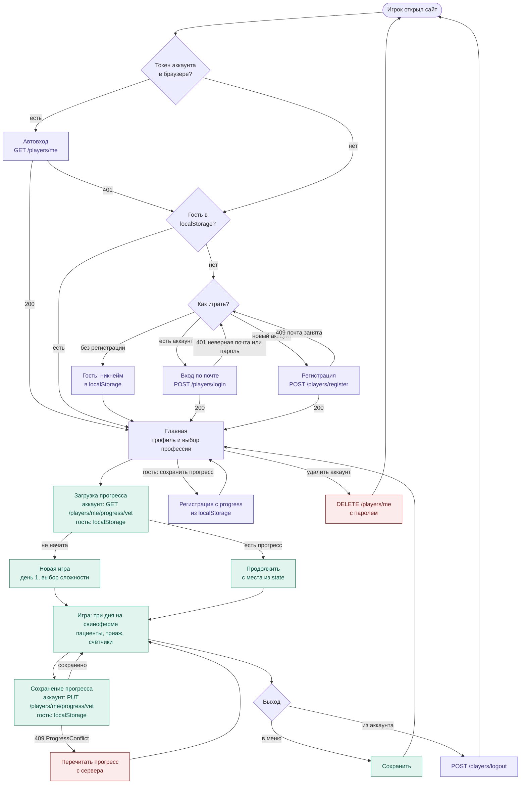

# Схема приложения: от входа до выхода

Путь игрока по ТЗ v2.0. Аккаунты и серверный прогресс реализованы в backend;
гостевой режим и игровые экраны — на фронтенде (Vue).

Все пути API — с префиксом `/api/v1`. Токен аккаунта передаётся в заголовке `Authorization: Player <token>`.

## Этапы

### 1. Вход
- **Токен аккаунта в браузере** — `GET /players/me`: `200` — сразу на главную; `401` — сессия истекла
  или аккаунт удалён, токен стираем.
- **Играть без регистрации** — только фронт: никнейм (не уникален) и прогресс в `localStorage`, на сервер ничего
  не уходит. Обновление страницы прогресс не сбрасывает. С другого устройства гость начинает заново —
  показываем подсказку «Зарегистрируйтесь, чтобы играть с любого устройства».
- **Вход по почте** — `POST /players/login { email, password }`. Ошибка одна на неверную почту и неверный пароль.
- **Регистрация** — `POST /players/register { email, password, nickname }`. Почта уникальна, пароль от 8 символов,
  без подтверждения почты и восстановления пароля.
- Успешный вход/регистрация возвращает `token` (сессия на 30 дней с последнего использования) — в `localStorage`.

### 2. Гость → аккаунт
- **«Сохранить прогресс»** — `POST /players/register` c `progress` из `localStorage`:
  аккаунт создаётся сразу с ним, регистрация не означает «начать заново».
- **«Уже есть аккаунт»** — `POST /players/login` c `progress`: прогресс переносится в профессии, не начатые
  в аккаунте (`importedProfessions`); где начаты — остаётся прогресс аккаунта (`skippedProfessions`).
- После успеха фронт стирает гостя из `localStorage`.

### 3. Главная и старт игры
- Главная: профиль (уровень и процент), кнопка профессии «Ветеринар», страница описания профессии.
- Прогресс: у аккаунта — `GET /players/me/progress/vet` (`revision: 0` — не начата), у гостя — `localStorage`.

### 4. Игра и сохранение
- Глава — три игровых дня на свиноферме, побочные пациенты, триаж; счётчики выручки, репутации и здоровья поросят
  хранятся в `state`.
- Сохранение в контрольных точках (после сцены, в конце дня, по кнопке). У аккаунта —
  `PUT /players/me/progress/vet` с `{ level, percent, difficulty, state, expectedRevision }`:
  - `200` — в ответе новая `revision`, её передаём в следующем сохранении;
  - `409 ProgressConflict` — игра открыта в другой вкладке: перечитываем прогресс и продолжаем с него.
- Удобно: `level` — номер игрового дня, `percent` — процент прохождения главы.

### 5. Выход и удаление
- **В меню** — сохранить и вернуться на главную.
- **Из аккаунта** — `POST /players/logout`: токен этого устройства перестаёт работать, другие устройства — нет.
- **Удалить аккаунт** — `DELETE /players/me { password }`: аккаунт, прогресс и сессии на всех устройствах.
- **Гость «выходит»**, очищая `localStorage` (фронт предупреждает, что прогресс пропадёт).

Администратор в этом пути не участвует: он отдельно смотрит аккаунты и их прогресс
(`/test/admin.html`, API `/api/v1/admin/*`). Гостей сервер не видит.
