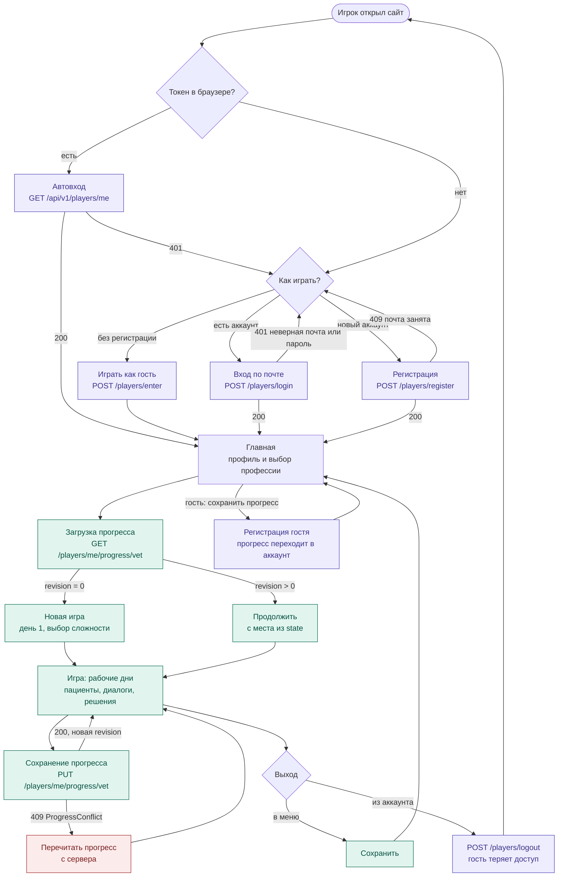

# Схема приложения: от входа до выхода

Путь игрока в общих чертах. Вход, аккаунты и прогресс реализованы в backend,
игровые экраны — предлагаемая логика для фронтенда (Vue).

Все пути API — с префиксом `/api/v1`. Токен сессии передаётся в заголовке `Authorization: Player <token>`.

## Этапы

### 1. Вход
- **Токен уже есть в браузере** — `GET /players/me`: `200` — сразу на главную, `401` — токен недействителен
  (истёк или был выход), показываем выбор входа.
- **Играть без регистрации** — `POST /players/enter { nickname }`: создаётся гость. Никнейм — только как к нему
  обращаются персонажи, он не уникален. Прогресс гостя доступен только из этого браузера.
- **Вход по почте** — `POST /players/login { email, password }`. Ошибка одна на неверную почту и неверный пароль.
- **Регистрация** — `POST /players/register { email, password, nickname }`. Почта уникальна, пароль от 8 символов,
  подтверждения почты и восстановления пароля нет.
- Каждый успешный вход возвращает `token` — фронт кладёт его в `localStorage`.
  Сессия гостя бессрочная, сессия аккаунта — 30 дней с последнего использования.

### 2. Гость → аккаунт
- **«Сохранить прогресс»** — `POST /players/register` с токеном гостя: гость становится аккаунтом,
  прогресс остаётся (это та же запись), выдаётся новый токен.
- **«Уже есть аккаунт»** — `POST /players/login` с токеном гостя: прогресс гостя переносится в профессии,
  не начатые в аккаунте (`transferredProfessions`); где начаты оба — остаётся прогресс аккаунта
  (`discardedProfessions`). Фронт предупреждает об этом до входа.

### 3. Главная и старт игры
- Главная: профиль (уровень и процент по профессии) и кнопка профессии «Ветеринар».
- `GET /players/me/progress/vet`:
  - `revision: 0` — профессия не начата: новая игра с первого дня, выбор сложности;
  - `revision > 0` — продолжение с места из `state` (день, сцена, флаги диалогов).

### 4. Игра и сохранение
- Рабочие дни: пациенты и хозяева, диалоги, выбор лечения.
- Сохранение в контрольных точках (после сцены, в конце дня, по кнопке):
  `PUT /players/me/progress/vet` с `{ level, percent, difficulty, state, expectedRevision }`.
  - `200` — в ответе новая `revision`, её передаём в следующем сохранении;
  - `409 ProgressConflict` — игра открыта в другой вкладке: перечитываем прогресс и продолжаем с него.

### 5. Выход
- **В меню** — сохранить и вернуться на главную (там виден обновлённый процент).
- **Из аккаунта** — `POST /players/logout`: токен этого устройства перестаёт работать.
  Гостя фронт предупреждает: после выхода вернуться к его прогрессу нельзя.
- **Закрыл вкладку** — на сервере остаётся прогресс последнего сохранения, токен — в браузере.

Администратор в этом пути не участвует: он отдельно смотрит всех игроков (гостей и аккаунты) и их прогресс
(`/test/admin.html`, API `/api/v1/admin/*`).
